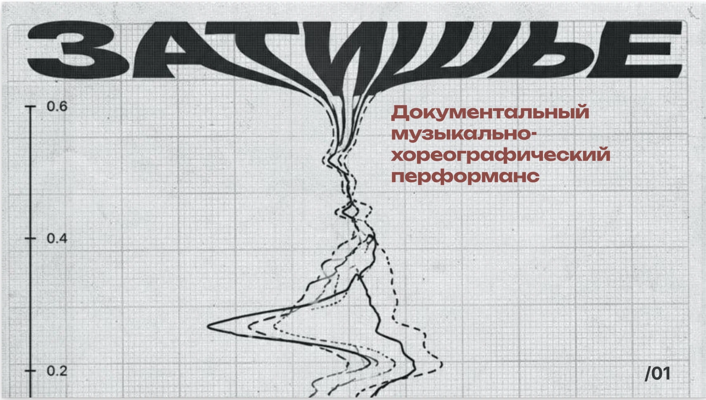

# Портфолио Надежды Страховой

Для просмотра откройте `index.html` в браузере. Фотографии, подложка и Montserrat уже в папке `assets`. Сайт работает без сборки.

## Публикация на GitHub Pages

1. Создайте публичный репозиторий на GitHub, например `portfolio`.
2. Загрузите в корень репозитория содержимое этой папки. `index.html`, `styles.css`, `gallery.js`, `.nojekyll` и папка `assets` должны быть на одном уровне. В Finder сочетание **⌘ Shift .** показывает скрытый файл `.nojekyll`.
3. В настройках репозитория откройте **Settings → Pages**. В **Source** выберите **Deploy from a branch**, затем ветку `main` и папку `/(root)`. Нажмите **Save**.
4. Когда публикация завершится, адрес сайта появится в **Settings → Pages**.

[Инструкция GitHub Pages](https://docs.github.com/en/pages/getting-started-with-github-pages/configuring-a-publishing-source-for-your-github-pages-site)

## Как изменить фотографии и подписи

В `index.html` найдите название проекта и его блок `<div class="gallery">`. Каждая фотография находится в отдельном блоке `<figure>…</figure>`. Перенесите блок целиком, чтобы изменить порядок. Для подписи добавьте `<figcaption>` после ссылки внутри блока.

```html
<figure>
  <a href="assets/projects/zatishye/01.webp" target="_blank" rel="noopener">
    
  </a>
  <figcaption>Титульный слайд проекта «Затишье».</figcaption>
</figure>
```

При добавлении новой фотографии положите её в соответствующую папку внутри `assets/projects`, затем укажите путь в `href` и `src`. Задайте фактические размеры файла в `width` и `height` и кратко опишите изображение в `alt`.

В галерее показывается по одному кадру. Если в проекте несколько фотографий, стрелки над ними листают по кругу. Клик по фотографии открывает её в полном размере. Горизонтальные и вертикальные кадры автоматически вписываются в рамку целиком.

Лицензия шрифта Montserrat находится в `assets/fonts/OFL.txt`.
